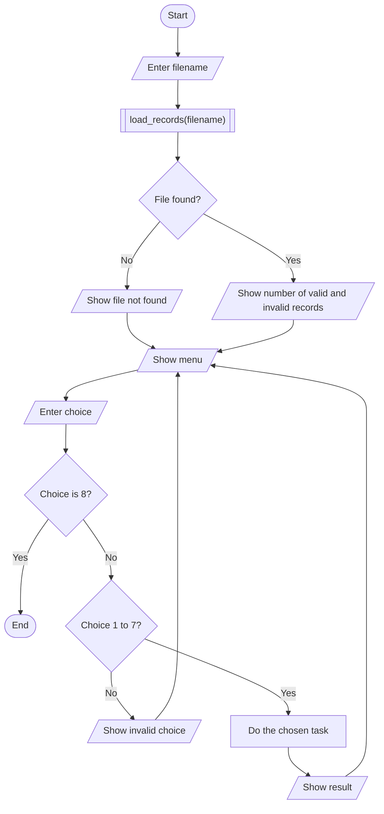
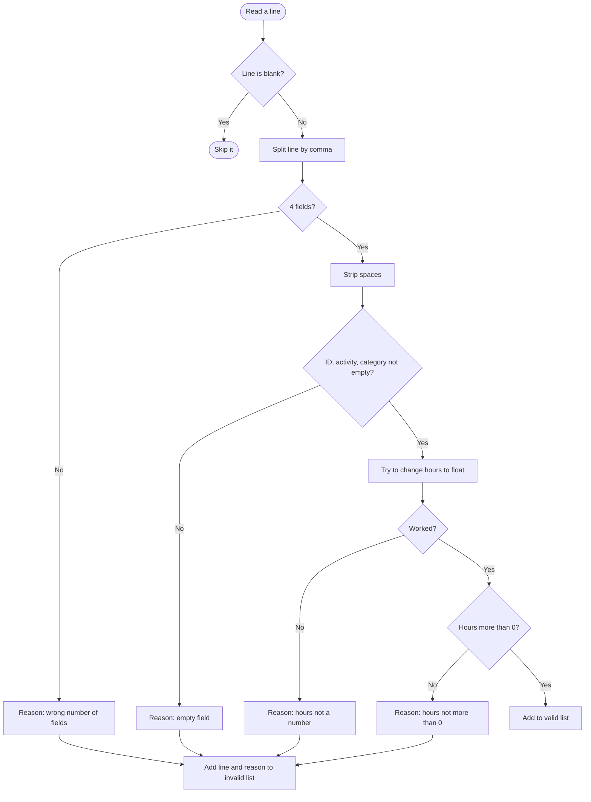

# SE 100 Project - Stage 1
Campus Activity Data Analyzer
Team 04, Section m1/m2

## 1. Flowchart

Main program:



Validation of one line (inside load_records):



## 2. Pseudocode

Constants:
```
EXPECTED_FIELDS = 4
REPORT_NAME = "activity_summary.txt"
```

How the data is stored:
```
record = [student_id, activity, category, hours]
valid_records = list of records
invalid_records = list of [line_number, line, reason]
category_counts = dictionary  (category in lowercase : count)
unique_students = set of student IDs
```

### activity_data.py

```
FUNCTION parse_line(line)
    fields = split line by ","
    IF number of fields is not 4
        RETURN None, "Wrong number of fields"
    student_id = fields[0] without spaces
    activity = fields[1] without spaces
    category = fields[2] without spaces
    hours_text = fields[3] without spaces
    IF student_id or activity or category is empty
        RETURN None, "Empty field"
    TRY
        hours = float(hours_text)
    EXCEPT ValueError
        RETURN None, "Hours is not a number"
    IF hours <= 0
        RETURN None, "Hours must be more than 0"
    RETURN [student_id, activity, category, hours], ""

FUNCTION load_records(filename)
    valid_records = empty list
    invalid_records = empty list
    TRY
        open the file
        skip the header line
        line_number = 1
        FOR each line in the file
            line_number = line_number + 1
            IF line is blank
                go to next line
            record, reason = parse_line(line)
            IF record is not None
                add record to valid_records
            ELSE
                add [line_number, line, reason] to invalid_records
        close the file
    EXCEPT FileNotFoundError
        RETURN [], [], False
    RETURN valid_records, invalid_records, True

FUNCTION format_record(record)
    RETURN the 4 fields in one line, hours with 2 decimal places

FUNCTION write_report(valid_records, invalid_records, stats, category_counts, unique_count)
    TRY
        open REPORT_NAME for writing
        write number of valid and invalid records
        write total hours, average hours, highest record
        write each category and its count
        write number of unique students
        write each invalid line and its reason
        close the file
    EXCEPT OSError
        RETURN False
    RETURN True
```

### activity_analysis.py

```
FUNCTION search_by_student(records, student_id)
    matches = empty list
    FOR each record in records
        IF record student_id is the same as student_id
            add record to matches
    RETURN matches

FUNCTION filter_by_category(records, category)
    matches = empty list
    FOR each record in records
        IF record category in lowercase is the same as category in lowercase
            add record to matches
    RETURN matches

FUNCTION calculate_statistics(records)
    IF records is empty
        RETURN 0, 0, 0, None
    count = 0
    total = 0
    highest = first record
    FOR each record in records
        count = count + 1
        total = total + record hours
        IF record hours > highest hours
            highest = record
    average = total / count
    RETURN count, total, average, highest

FUNCTION count_categories(records)
    category_counts = empty dictionary
    FOR each record in records
        key = record category in lowercase
        IF key is in category_counts
            category_counts[key] = category_counts[key] + 1
        ELSE
            category_counts[key] = 1
    RETURN category_counts

FUNCTION get_unique_students(records)
    unique_students = empty set
    FOR each record in records
        add record student_id to unique_students
    RETURN unique_students
```

### main.py

```
FUNCTION display_menu()
    print the 8 menu options

FUNCTION display_records(records)
    IF records is empty
        print "No records found"
    ELSE
        print headings
        FOR each record in records
            print format_record(record)

FUNCTION main()
    ask the user for filename
    valid_records, invalid_records, found = load_records(filename)
    IF found is False
        print "File not found"
    ELSE
        print how many valid and invalid records

    choice = ""
    WHILE choice is not "8"
        display_menu()
        ask the user for choice
        IF choice is "1"
            display_records(valid_records)
        ELSE IF choice is "2"
            ask for student ID
            display_records(search_by_student(valid_records, student_id))
        ELSE IF choice is "3"
            ask for category
            display_records(filter_by_category(valid_records, category))
        ELSE IF choice is "4"
            stats = calculate_statistics(valid_records)
            IF count is 0
                print "No valid records"
            ELSE
                print count, total, average, highest record
        ELSE IF choice is "5"
            counts = count_categories(valid_records)
            unique = get_unique_students(valid_records)
            print each category and count
            print number of unique students
        ELSE IF choice is "6"
            IF invalid_records is empty
                print "No invalid records"
            ELSE
                print each invalid line and reason
        ELSE IF choice is "7"
            saved = write_report(...)
            IF saved
                print "Report saved"
            ELSE
                print "Could not save report"
        ELSE IF choice is "8"
            print "Goodbye"
        ELSE
            print "Wrong choice, enter 1 to 8"

CALL main()
```

## 3. Initial Test Plan

Starter file: activity_records.csv (10 valid lines, 6 invalid lines).

| # | Type | What we test | Input | Expected result |
|---|------|--------------|-------|-----------------|
| 1 | Normal | Load the starter file | activity_records.csv | 10 valid, 6 invalid |
| 2 | Normal | Statistics | Option 4 | Count 10, total 31.00, average 3.10, highest is Food Bank Support (6.00) |
| 3 | Normal | Search by student ID | Option 2, ID 20261001 | 2 records (Robotics Workshop and Python Seminar) |
| 4 | Normal | Category filter, different case | Option 3, category TECHNICAL | 3 records |
| 5 | Normal | Category counts | Option 5 | technical 3, sports 2, volunteer 2, academic 2, recreation 1. Unique students 8 |
| 6 | Boundary | Student not found | Option 2, ID 99999999 | Message that no record was found |
| 7 | Empty data | File with only the header | empty_data.csv | 0 valid, 0 invalid. Option 4 shows a message, no crash |
| 8 | Boundary | Smallest valid hours | Line 20261050,Quick Talk,Academic,0.01 | Line is valid, hours shown as 0.01 |
| 9 | Invalid | Hours is text | 20261009,Invalid Hours,Technical,zero | Rejected, reason: hours not a number |
| 10 | Invalid | Hours is 0 or negative | Lines with hours 0 and -1 | Both rejected |
| 11 | Invalid | Too many fields | 20261013,Too,Many,Fields,2 | Rejected, reason: wrong number of fields |
| 12 | Invalid | Empty field | ,Missing Student,Technical,2 | Rejected, reason: empty field |
| 13 | Invalid | File does not exist | no_such_file.csv | "File not found" message, program does not crash |
| 14 | Normal | Save report | Option 7 | activity_summary.txt is created and a message is shown |

Note: blank lines in the file are skipped (we do not count them as invalid).
